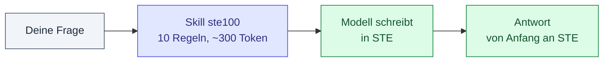
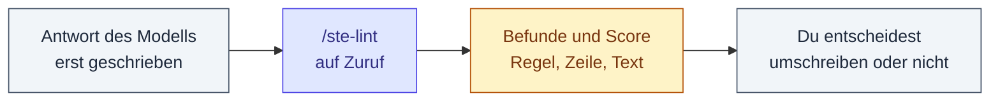
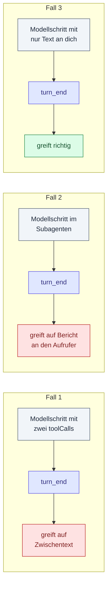
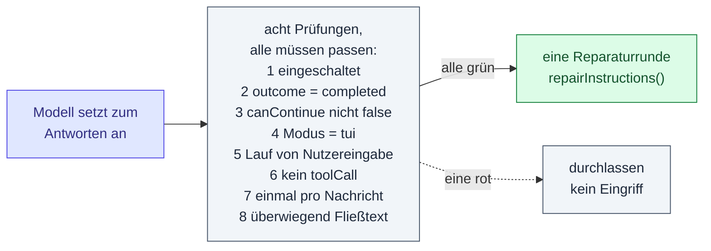
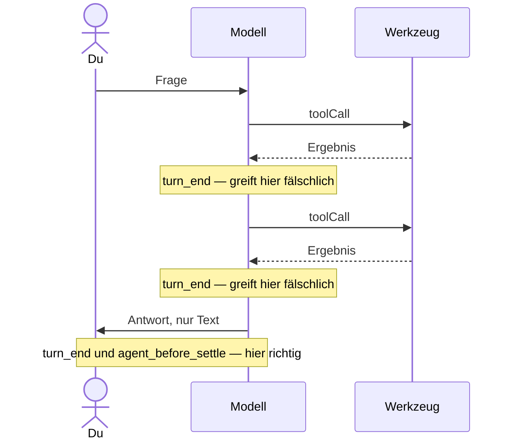

# Abläufe: Skill, Linter, Haken

Stand 2026-11-16. Fünf Bilder zu der Frage, wie der Linter in den Schreibablauf
eingreift — oder auch nicht.

Legende: grün = tut das Richtige · gelb = Prüfung mit Befund · rot = greift am
falschen Ort · blau = Haken oder Werkzeug.

## A · Skill: Anweisung vor dem Schreiben

Heute im Einsatz. Verhindert Verstöße, statt sie zu finden.

Kosten: eine Ladung Regeln, keine Nacharbeit. Grenze: das Modell kann Regeln
trotzdem übergehen.

## B · Linter auf Zuruf

Heute im Einsatz als `/ste-lint`. Prüft, was schon geschrieben ist.

Kosten: null bis zum Aufruf. Grenze: die Nacharbeit bleibt bei dir.

## C · Haken an `turn_end` — verworfen

Feuert bei jedem Modellschritt, also auch mitten in einer Werkzeugkette und in
Subagenten-Sitzungen.

Zwei von drei Fällen sind falsch. Deshalb nicht `turn_end`.

## D · Haken an `agent_before_settle` mit acht Prüfungen

Feuert erst, wenn das Modell aufhört, und lässt nur durch, was wirklich eine
Antwort an dich ist.

Der Haken sitzt am Ende des Laufs. Er sieht nur fertige Antworten an dich.

## E · Wo die Haken in einem Lauf sitzen

Dieselbe Antwort, drei Modellschritte. Der Unterschied ist der Zeitpunkt.

`turn_end` kommt dreimal, die Antwort an dich ist nur der letzte Schritt.

## Quelle der Aussagen

pi-Typen `TurnEndEvent` (mit `turnIndex`, `message`, `toolResults`),
`AgentBeforeSettleEvent` (mit `outcome`) und `AgentActivityOutcome`. Die
Umsetzung steht in [`../extensions/guard.js`](../extensions/guard.js), die
Begründung in [`entscheidungen.md`](entscheidungen.md).
