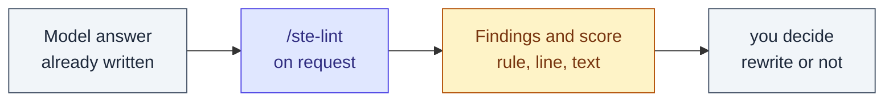
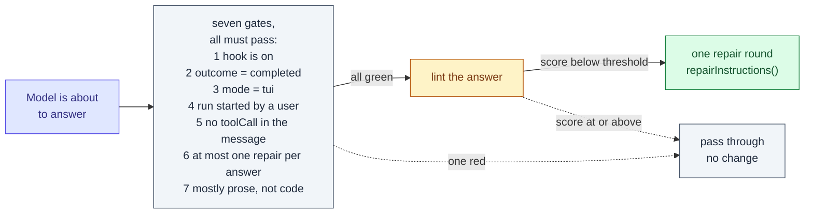
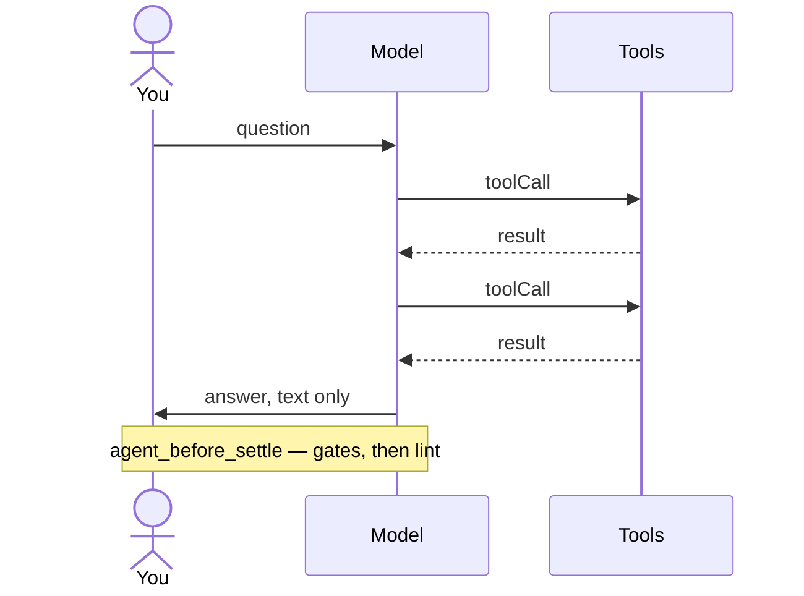

# Flows

How the linter reaches a text, and where the repair hook sits. State as built,
version 0.1.8.

Legend: green = does the right thing · amber = check with a finding · blue = hook
or command.

## A · Skill: rules before writing

Writes in simplified technical language from the start.

Cost: one load of the rules, no rework. Limit: the model can still break a rule.

## B · Linter on request

The `/ste-lint` command. Checks what has already been written.

Cost: nothing until you call it. Limit: the rework is yours.

## C · Repair hook on `agent_before_settle`

Runs once, when the model is about to finish. Seven gates must pass before it
touches the answer.

The footer carries the score of every answer to you — `STE(85) Current: 74` — and
keeps a finished round visible as `STE(85) Current: 74 → 94`. That number costs no
model round; it is a lint of a text that already exists.

Threshold default 90, set with `/ste-guard on 85`. Gate 1 starts from
`<agent-dir>/ste-lint.json` (shipped copy: `assets/ste-lint.json`); the command
changes it for the session only. One repair per answer: the
continuation itself is not treated as a user run, so gate 6 is the loop stop.
Every decision is logged with a reason code when `PI_STE_LINT_DEBUG` is set.

The round is visible: notification with score and fix count, a banner in the
transcript, and the footer moving from `Current: 36` to `Current: 36 → …` and
finally `Current: 36 → 94`. Nothing of that reaches the model context.

## D · Where the hook sits in one run

One answer, three model steps. Only the last one is an answer to you.

Tool steps pass without a check. The hook sees a finished answer or nothing.

## Source of the statements

pi types `AgentBeforeSettleEvent` (with `outcome`) and `AgentActivityOutcome`.
The implementation is in [`../extensions/guard.js`](../extensions/guard.js) and
[`../extensions/settings.js`](../extensions/settings.js), the
reasons in [`decisions.md`](decisions.md).
